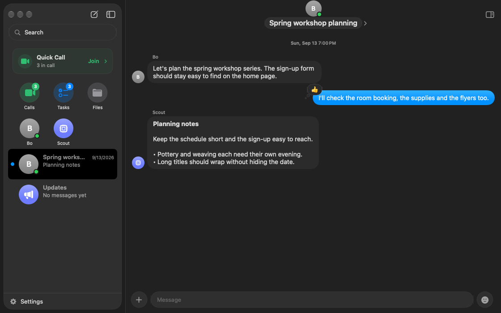
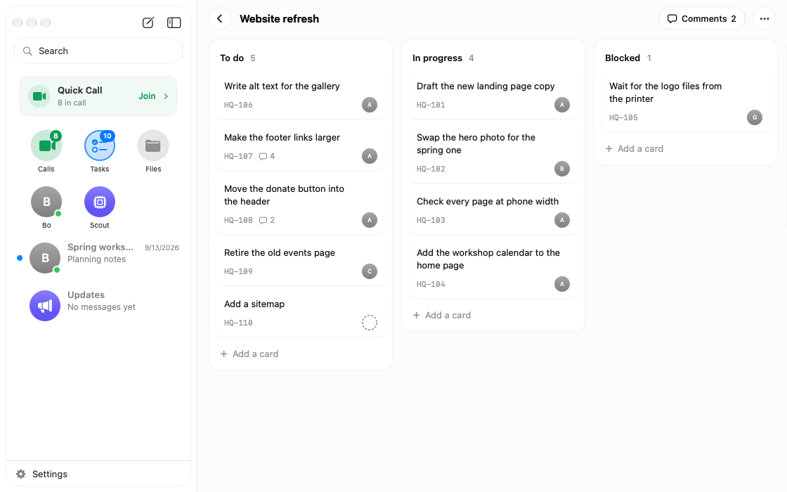

<div align="center">
  
  <h1>HQ Community</h1>
  <p><strong>Team chat with an AI teammate, on your own server.</strong></p>
  <p>
    <a href="#quick-start">Quick start</a> ·
    <a href="#what-you-get">Features</a> ·
    <a href="clients/apple">Native apps</a> ·
    <a href="#documentation">Docs</a> ·
    <a href="https://github.com/EcoGPT/company-hq/releases">Releases</a>
  </p>
  <p>
    <a href="https://github.com/EcoGPT/company-hq/actions/workflows/ci.yml"></a>
    <a href="LICENSE"></a>
  </p>
</div>



<p align="center"><sub>The real Mac app, shown with sample data.</sub></p>

HQ combines rooms and DMs, shared tasks and docs, and an assistant that uses
real tools. Run the server as one Bun process with SQLite and no build step.
Your team uses the native Mac and iPhone apps; coding agents connect over MCP.

## Quick start

Install [Bun](https://bun.sh) 1.3 or newer, then:

```sh
git clone https://github.com/EcoGPT/company-hq.git hq
cd hq
bun install
bun hq setup --name "Ada Lovelace" --handle ada
bun dev
```

Setup creates your first admin and prints a server address and a private
sign-in key. It offers Ollama, an OpenAI-compatible endpoint, or Anthropic for
the assistant. Choose a model with tool calling to let it act on requests.
"Skip for now" runs an offline demo that echoes messages without calling tools.

**Open the native app.** This is a source release: [build the Mac or iPhone
app](clients/apple), then enter the address and sign-in key. The build guide
covers macOS 15+, Xcode 26.6 and XcodeGen; the iPhone app targets iOS 18+.

The default `http://localhost:8787` address works on the server's own Mac.
For another device, set `HQ_HOST=0.0.0.0` and `HQ_PUBLIC_URL` to an address it can
reach. Use HTTPS, or a `.local` hostname for local HTTP.
[Getting started](docs/getting-started.md) covers the complete setup.

You can also use HQ from the terminal:

```sh
bun hq chat                      # talk to the assistant
bun hq invite bo --name "Bo Chen" # invite a teammate
bun hq doctor                    # inspect the server and its configuration
```

The printed setup and invite keys sign devices into the app. For API or MCP
access, create a separate key with `bun hq key <handle>`.

## What you get

| Built in                    | What it does                                                                                                |
| --------------------------- | ----------------------------------------------------------------------------------------------------------- |
| **Team conversations**      | Rooms, DMs, replies, reactions, mentions, attachments and read state in native Mac and iPhone apps.         |
| **Tasks and agents**        | Projects, task owners and due dates, plus a board of coding sessions your team chooses to share.            |
| **Docs and shared files**   | Versioned Markdown docs and a library of files shared in chat.                                              |
| **Meetings and reminders**  | Meeting schedules, room or DM reminders, and per-person calendar feeds.                                     |
| **An assistant with tools** | Mention `@atlas` in a room or send it a DM to use the configured app tools. Choose a local or hosted model. |
| **Your integrations**       | Read GitHub issues, PRs and files through the bundled connector, or add your own connectors and MCP tools.  |

<details>
<summary>See the task board</summary>

<picture>
  <source media="(prefers-color-scheme: dark)" srcset="docs/images/hq-board-dark.png">
  
</picture>

The same Mac app, showing the sample workspace's project board.

</details>

## Make it your team's HQ

An app definition brings together its tables, tools, HTTP routes and scheduled
work. Start with a working app instead of an empty file:

```sh
bun hq new app standup --description "Daily check-ins"
bun test apps/standup
```

The generator creates an app, store and test, and registers it in
[`hq.config.ts`](hq.config.ts). The dev server picks it up.
[The app guide](docs/apps.md) explains `defineApp`, input schemas and tests.

Edit [`assistant/persona.md`](assistant/persona.md) to change how Atlas speaks.
Use `bun hq connect` to see connectors, or `bun hq connect github` to configure
read access. Connector secrets are encrypted in the vault and supplied to the
tool when it runs.

MCP clients use `/mcp` with a key from `bun hq key <handle>`. Tools act as that
person and respect room access; assistant-only tools are not exposed.
[Connect a coding agent or desktop client](docs/mcp.md).

## Run with Docker

Copy the example configuration and set `HQ_PUBLIC_URL` and your model settings
in `.env`. Keep `HQ_DB` and `HQ_HOST` unset: the image already uses `/data` and
listens on all interfaces.

```sh
cp .env.example .env
# Edit .env before starting the container.
docker build -t hq .
docker run -d --name hq -p 8787:8787 \
  -v hq-data:/data --env-file .env hq
docker exec hq bun hq setup --name "Ada Lovelace" --handle ada
docker restart hq
docker exec hq bun hq invite bo --name "Bo Chen"
```

Setup inside the container creates its first admin and vault key. Restarting
loads that key into the running server. The invite command prints the address
and key for your teammate.

Put the server behind an HTTPS proxy. Back up the whole `/data` volume,
including the SQLite WAL files, vault key, uploads and recordings. Keep model
endpoints reachable from the container; its `localhost` is the container itself.
[Deployment details](docs/getting-started.md#3-bring-the-team).

## Add services when you need them

The server boots without a paid AI service. Features that need extra services
or signing stay off until you configure them:

- **Calls and recaps:** bring a Cloudflare Realtime SFU for calls. Enabled calls
  record microphone audio on the server; transcription needs a speech-to-text
  provider. [Calls and recording](docs/calls.md).
- **Semantic search:** configure an embedding model for Docs search.
  [AI services](docs/ai.md).
- **Push and desktop widgets:** use a team-signed client and the required
  server configuration. [Push](docs/push.md) · [Widgets](docs/widgets.md).
- **Mac coding-session sync:** a team-signed build can share coding
  conversation text with your HQ after a consent notice; it can be paused.
  [What it reads and shares](clients/apple/docs/session-sync.md).

## Documentation

| Start here                                 | Build on it                        | Reference                            |
| ------------------------------------------ | ---------------------------------- | ------------------------------------ |
| [Getting started](docs/getting-started.md) | [Apps and SDK](docs/apps.md)       | [Architecture](docs/architecture.md) |
| [Mac and iPhone apps](clients/apple)       | [Automations](docs/automations.md) | [App protocol](docs/protocol.md)     |
| [Models](docs/providers.md)                | [Connectors](docs/connectors.md)   | [MCP](docs/mcp.md)                   |
| [The assistant](docs/assistant.md)         | [Meetings](docs/meetings.md)       | [Agents](docs/agents.md)             |

## Contribute

HQ Community is built by [EcoGPT](https://github.com/EcoGPT) and designed to be
forked. Read the [contributing guide](CONTRIBUTING.md), open an
[issue](https://github.com/EcoGPT/company-hq/issues), or send a small PR.

Report vulnerabilities through
[private vulnerability reporting](https://github.com/EcoGPT/company-hq/security/advisories/new).
The [security policy](SECURITY.md) explains the scope.

[MIT licensed](LICENSE).
